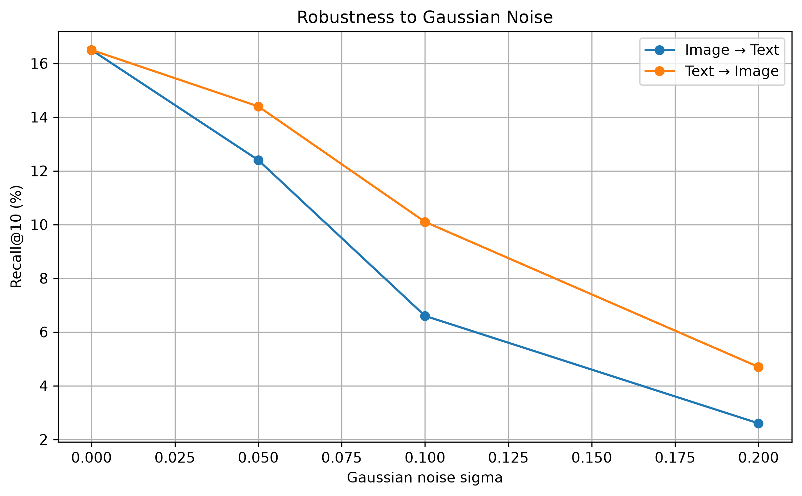
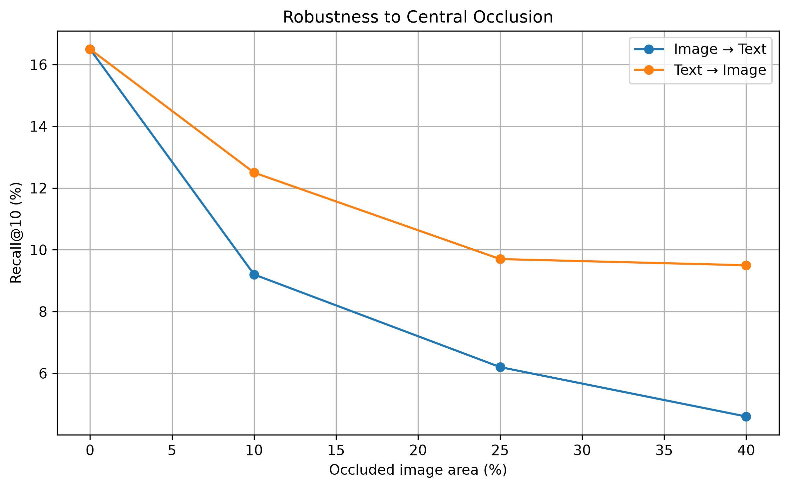
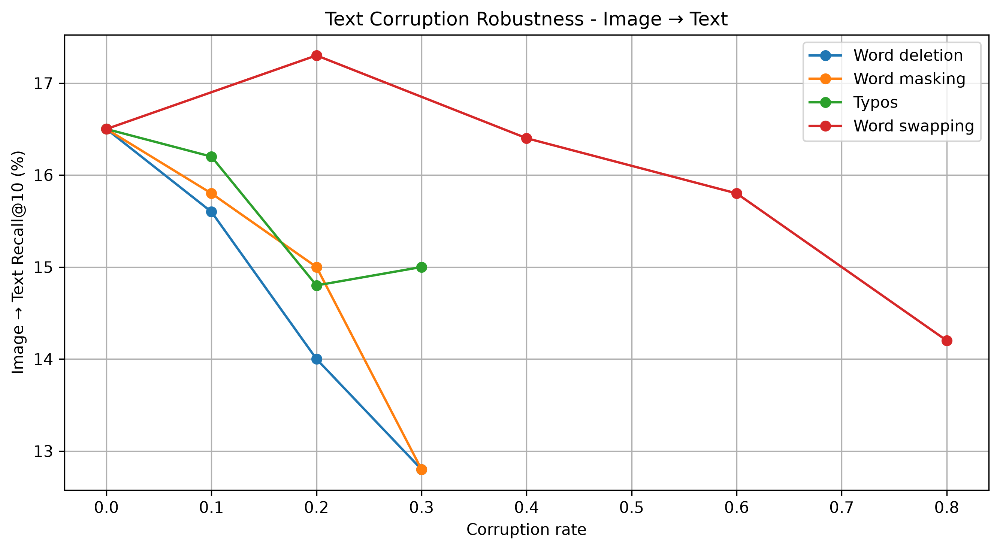
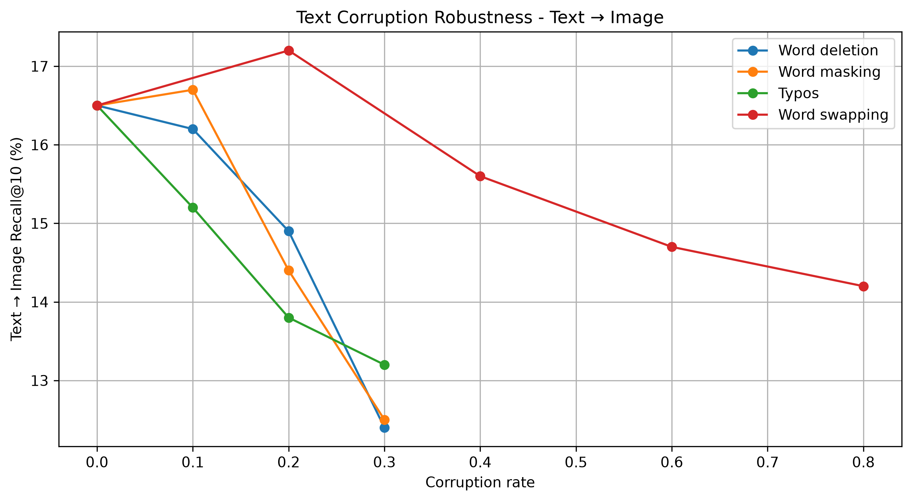
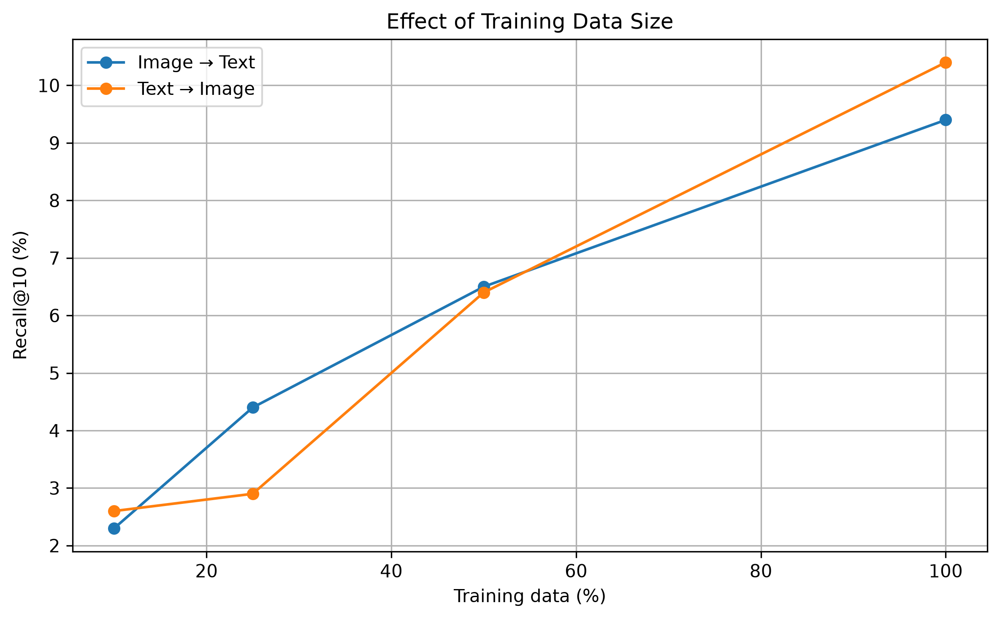
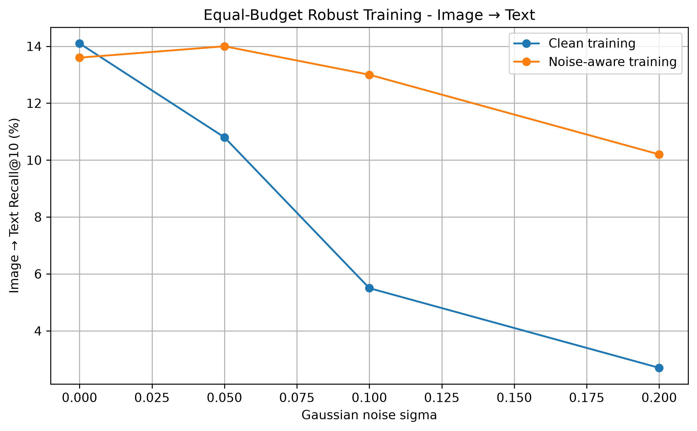
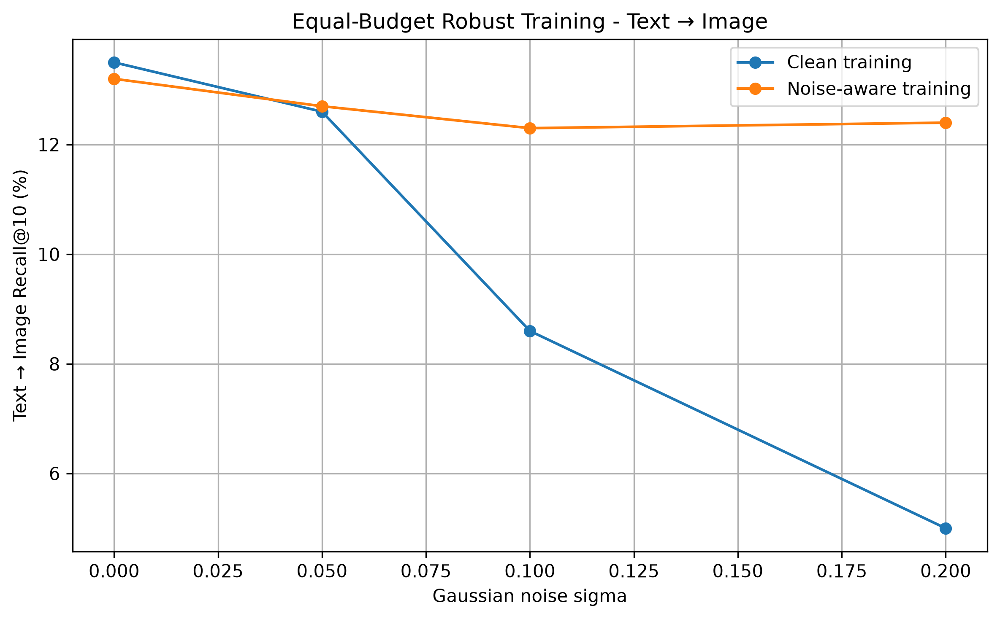
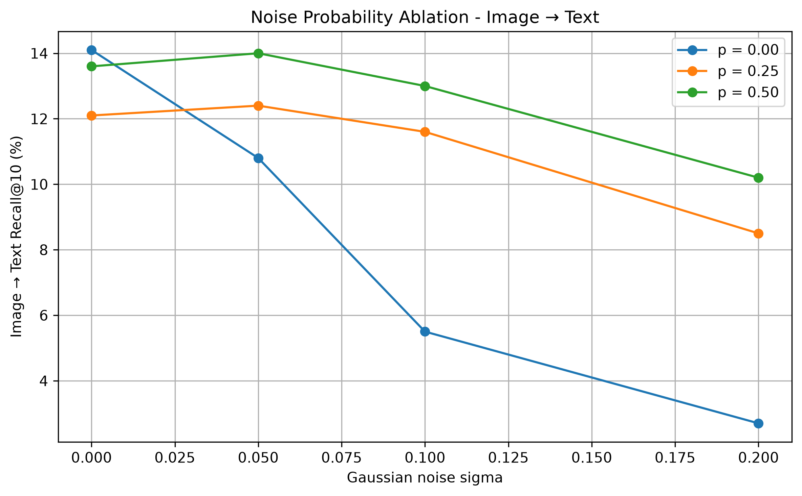

# RobustCLIP-Lite

**Robust Multimodal Representation Learning under Limited Data**

RobustCLIP-Lite is a small vision-language model built from scratch to study how multimodal representations behave under:

- limited training data,
- image corruptions,
- text corruptions,
- and corruption-aware contrastive training.

The project is inspired by CLIP-style contrastive learning, but uses lightweight custom image and text encoders instead of pretrained backbones.

The main objective is not to compete with large pretrained vision-language models, but to understand experimentally how multimodal alignment is learned, how it fails under distribution shifts, and whether simple robust training strategies can improve it.

---

## Research Questions

This project investigates the following questions:

1. How well can a lightweight vision-language model learn image-text alignment from scratch on Flickr8k?
2. How sensitive are the learned representations to image and text corruptions?
3. How does reducing the amount of training data affect multimodal retrieval?
4. Can corruption-aware contrastive training improve robustness?
5. What is the trade-off between clean performance and robustness?

---

## Main Results

The experiments show three main trends:

- Retrieval performance strongly depends on the amount of training data.
- A model trained only on clean data can be highly sensitive to image corruptions, especially Gaussian noise and occlusion.
- Gaussian-noise-aware training dramatically improves robustness while preserving most of the clean retrieval performance.

At equal training budget, under strong Gaussian noise (`sigma = 0.20`):

| Training | Image → Text R@10 | Text → Image R@10 |
|---|---:|---:|
| Clean training | 2.7% | 5.0% |
| Noise-aware training | **10.2%** | **12.4%** |

The noise-aware model therefore retains substantially more retrieval performance under corruption.

---

## 1. Dataset

The project uses **Flickr8k**.

Each image is associated with five natural-language captions:

```text
caption_0
caption_1
caption_2
caption_3
caption_4
```

Dataset split:

```text
train : 6000 images
dev   : 1000 images
test  : 1000 images
```

During training, one of the five captions is sampled randomly for each image.

During validation and testing, `caption_0` is used deterministically to ensure reproducible evaluation.

---

## 2. Text Preprocessing

A simple word-level tokenizer is implemented from scratch.

Processing:

```text
lowercase
→ whitespace tokenization
→ vocabulary lookup
→ padding / truncation
```

Vocabulary settings:

```text
Minimum word frequency : 2
Vocabulary size        : 4519
Maximum caption length : 32 tokens
<PAD> token            : 0
<UNK> token            : 1
```

This simple tokenizer also makes the model sensitive to spelling errors.

For example:

```text
woman → known vocabulary token
owman → <UNK>
```

This behavior is explicitly studied in the typo robustness experiments.

---

## 3. Model Architecture

RobustCLIP-Lite contains two independently trained encoders.

### Image Encoder

The image encoder is a lightweight CNN trained from scratch.

```text
Input
[3, 224, 224]
Conv + ReLU + MaxPool
3 → 32
Conv + ReLU + MaxPool
32 → 64
Conv + ReLU + MaxPool
64 → 128
Conv + ReLU + MaxPool
128 → 256
Adaptive Average Pooling
Flatten
↓
256-dimensional feature vector
```

Spatial resolution:

```text
224
→ 112
→ 56
→ 28
→ 14
```

---

### Text Encoder

The text encoder uses:

- learned token embeddings,
- learned positional embeddings,
- a Transformer Encoder,
- masked mean pooling.

Main configuration:

```text
Embedding dimension   : 256
Maximum length        : 32
Attention heads       : 4
Transformer layers    : 2
Feed-forward dimension: 1024
```

Pipeline:

```text
Token IDs
↓
Token Embeddings
+
Positional Embeddings
↓
Transformer Encoder
↓
Masked Mean Pooling
↓
256-dimensional text representation
```

---

### Projection Heads

Both image and text representations are projected into the same embedding space:

```text
256 → 128
```

The projected representations are L2-normalized.

Final embeddings:

```text
Image embedding : [B, 128]
Text embedding  : [B, 128]
```

Because the embeddings are normalized, their dot product corresponds to cosine similarity.

---

## 4. Contrastive Learning

For a batch of size `B`:

```text
image embeddings : [B, 128]
text embeddings  : [B, 128]
```

The similarity matrix is:

```python
similarities = image_embeddings @ text_embeddings.T
```

with shape:

```text
[B, B]
```

The diagonal represents matching image-caption pairs.

All other entries act as in-batch negatives.

A symmetric contrastive loss is used:

```text
Image → Text Cross Entropy
+
Text → Image Cross Entropy
--------------------------------
                2
```

A learnable temperature / logit scale is also used.

Initial temperature:

```text
0.07
```

---

## 5. Training Setup

Main training configuration:

```text
Optimizer      : AdamW
Learning rate  : 3e-4
Batch size     : 32
Input size     : 224 × 224
Embedding size : 128
```

Early stopping is based on validation loss.

Typical patience:

```text
3 validation checks without improvement
```

Experiments use fixed random seeds where stochastic corruption is involved.

Main seed:

```text
42
```

---

## 6. Evaluation

The model is evaluated as an image-text retrieval system.

Metrics:

```text
Recall@1
Recall@5
Recall@10
```

Both retrieval directions are evaluated:

```text
Image → Text
Text → Image
```

For the current deterministic evaluation protocol, one caption (`caption_0`) is associated with each image.

For 1000 candidates, approximate random retrieval performance is:

```text
R@1  ≈ 0.1%
R@5  ≈ 0.5%
R@10 ≈ 1.0%
```

---

## 7. Clean Baseline

The best clean baseline checkpoint was selected using validation loss.

Best checkpoint:

```text
Epoch    : 24
Val loss : 2.6658
```

Clean test retrieval:

| Direction | R@1 | R@5 | R@10 |
|---|---:|---:|---:|
| Image → Text | 2.1% | 9.8% | **16.5%** |
| Text → Image | 2.5% | 10.2% | **16.5%** |

The absolute retrieval performance is intentionally modest because the model is lightweight, trained from scratch, and uses only Flickr8k.

However, the model performs clearly above random retrieval and provides a meaningful baseline for the robustness experiments.

---

## 8. Image Corruptions

The clean model was evaluated under four image corruptions:

- Gaussian noise
- Gaussian blur
- brightness changes
- central occlusion

---

### Gaussian Noise

Gaussian noise was added as:

```python
noisy_images = images + sigma * noise
```

followed by clipping to `[0, 1]`.

Results:

| Sigma | I→T R@10 | T→I R@10 |
|---:|---:|---:|
| 0.00 | 16.5% | 16.5% |
| 0.05 | 12.4% | 14.4% |
| 0.10 | 6.6% | 10.1% |
| 0.20 | 2.6% | 4.7% |

Gaussian noise is one of the most destructive corruptions observed.

<p align="center">
  
</p>

---

### Gaussian Blur

| Blur setting | I→T R@10 | T→I R@10 |
|---|---:|---:|
| Clean | 16.5% | 16.5% |
| k=3, sigma=0.5 | 15.7% | 14.9% |
| k=7, sigma=1.0 | 11.4% | 12.4% |
| k=11, sigma=2.0 | 9.0% | 9.4% |

Blur produces a progressive degradation, but is less destructive than strong Gaussian noise.

---

### Brightness

| Brightness factor | I→T R@10 | T→I R@10 |
|---:|---:|---:|
| 0.50 | 8.0% | 10.7% |
| 0.75 | 14.0% | 14.1% |
| 1.00 | 16.5% | 16.5% |
| 1.25 | 16.4% | 17.1% |
| 1.50 | 13.2% | 14.7% |

The model is relatively tolerant to moderate brightness changes, while strong darkening causes a larger degradation.

---

### Central Occlusion

The center of each image is replaced with a black square covering a controlled fraction of the total image area.

| Occluded area | I→T R@10 | T→I R@10 |
|---:|---:|---:|
| 0% | 16.5% | 16.5% |
| 10% | 9.2% | 12.5% |
| 25% | 6.2% | 9.7% |
| 40% | 4.6% | 9.5% |

Central occlusion strongly degrades retrieval, particularly in the Image → Text direction.

<p align="center">
  
</p>

---

## 9. Text Corruptions

The following text corruptions were studied:

- word deletion,
- word masking,
- word swapping,
- character-level typos.

---

### Word Deletion

| Deletion rate | I→T R@10 | T→I R@10 |
|---:|---:|---:|
| 0% | 16.5% | 16.5% |
| 10% | 15.6% | 16.2% |
| 20% | 14.0% | 14.9% |
| 30% | 12.8% | 12.4% |

---

### Word Masking

Masked words are replaced with `<UNK>`.

| Masking rate | I→T R@10 | T→I R@10 |
|---:|---:|---:|
| 0% | 16.5% | 16.5% |
| 10% | 15.8% | 16.7% |
| 20% | 15.0% | 14.4% |
| 30% | 12.8% | 12.5% |

---

### Word Swapping

Word swapping preserves the vocabulary content but changes local word order.

| Swap rate | I→T R@10 | T→I R@10 |
|---:|---:|---:|
| 0% | 16.5% | 16.5% |
| 20% | 17.3% | 17.2% |
| 40% | 16.4% | 15.6% |
| 60% | 15.8% | 14.7% |
| 80% | 14.2% | 14.2% |

Word order perturbations are surprisingly well tolerated.

This suggests that, under this architecture and task, retrieval depends more strongly on lexical content than on exact word order.

This does **not** mean that the Transformer ignores word order; positional embeddings are still present. It only indicates that the final learned representation is comparatively robust to this particular order corruption.

---

### Character-Level Typos

Typos are generated before tokenization by swapping adjacent characters.

Example:

```text
woman
↓
owman
```

Because the tokenizer is word-level, the corrupted word often becomes `<UNK>`.

| Typo rate | I→T R@10 | T→I R@10 |
|---:|---:|---:|
| 0% | 16.5% | 16.5% |
| 10% | 16.2% | 15.2% |
| 20% | 14.8% | 13.8% |
| 30% | 15.0% | 13.2% |

Typos reduce retrieval performance, especially in the Text → Image direction.

### Text Corruption Overview

<p align="center">
  
</p>

<p align="center">
  
</p>

---

## 10. Limited-Data Experiments

To study how data availability affects multimodal alignment, models were trained from scratch using:

```text
10%
25%
50%
100%
```

of the original training split.

All subsets were constructed using the same random ordering:

```text
10% ⊂ 25% ⊂ 50% ⊂ 100%
```

The vocabulary and evaluation sets were kept fixed.

Results:

| Training data | Best epoch | Best val loss | I→T R@10 | T→I R@10 |
|---:|---:|---:|---:|---:|
| 10% | 6 | 3.3086 | 2.3% | 2.6% |
| 25% | 9 | 3.1904 | 4.4% | 2.9% |
| 50% | 12 | 2.9982 | 6.5% | 6.4% |
| 100% | 11 | 2.7727 | 9.4% | 10.4% |

Retrieval performance increases strongly with the amount of training data.

In particular:

```text
Image → Text R@10
10%  → 2.3%
25%  → 4.4%
50%  → 6.5%
100% → 9.4%
```

The experiment confirms that learning multimodal alignment from scratch is highly data-dependent.

**Why the 100 % row (9.4 %) is lower than the clean baseline (16.5 %).** These runs used early stopping with a
patience of 3: the best validation loss was at epoch 11 and training stopped three epochs later. The baseline of section 7 was trained longer: it was resumed by hand and
reached its best validation loss at epoch 24. The rows of this table are comparable with each other (same recipe,
same stopping rule), but the 100 % row is an under-trained model, not the best model one can get from the full
training set.

<p align="center">
  
</p>

---

## 11. Corruption-Aware Training

The next question was whether robustness could be improved rather than only measured.

A simple Gaussian-noise-aware training strategy was introduced.

For each training image:

```text
probability p
↓
apply Gaussian noise
↓
contrastive training
```

The text modality remains unchanged.

Main configuration:

```text
Training Gaussian sigma : 0.10
Noise probability       : 0.50
Training budget         : 19 epochs
```

---

## 12. Equal-Budget Robustness Ablation

A clean model and a noise-aware model were both trained for exactly 19 epochs.

This controls for the number of training epochs and helps isolate the effect of corruption-aware training.

Two details of this first run are not perfectly symmetric. The clean model is the state after the 19th epoch, while
the noise-aware model is the checkpoint with the best clean validation loss (early stopping), which happened at
epoch 19. And the training noise level (`sigma = 0.10`) and probability (`p = 0.50`) were chosen after looking at
test results, so the test set was used for model selection here. Section 15 repeats the comparison over several
seeds with a strictly fixed protocol that avoids both issues.

Results:

| Test sigma | Clean I→T R@10 | Noise-aware I→T R@10 | Clean T→I R@10 | Noise-aware T→I R@10 |
|---:|---:|---:|---:|---:|
| 0.00 | **14.1%** | 13.6% | **13.5%** | 13.2% |
| 0.05 | 10.8% | **14.0%** | 12.6% | **12.7%** |
| 0.10 | 5.5% | **13.0%** | 8.6% | **12.3%** |
| 0.20 | 2.7% | **10.2%** | 5.0% | **12.4%** |

The noise-aware model sacrifices only a small amount of clean performance:

```text
Image → Text:
14.1% → 13.6%
Text → Image:
13.5% → 13.2%
```

while substantially improving robustness under stronger noise.

At `sigma = 0.20`:

```text
Image → Text
2.7% → 10.2%
Text → Image
5.0% → 12.4%
```

This represents a strong clean-robustness trade-off in favor of corruption-aware training.

### Image → Text

<p align="center">
  
</p>

### Text → Image

<p align="center">
  
</p>

---

## 13. Noise Probability Ablation

The probability of corrupting an image during training was also studied.

The following settings were compared:

```text
p = 0.00
p = 0.25
p = 0.50
```

All models used the same 19-epoch training budget.

Results:

| Noise probability | Clean I→T R@10 | sigma=0.20 I→T R@10 | Clean T→I R@10 | sigma=0.20 T→I R@10 |
|---:|---:|---:|---:|---:|
| 0.00 | **14.1%** | 2.7% | **13.5%** | 5.0% |
| 0.25 | 12.1% | 8.5% | 12.7% | 11.6% |
| 0.50 | 13.6% | **10.2%** | 13.2% | **12.4%** |

Among the tested values, `p = 0.50` provided the best overall robustness while preserving most of the clean retrieval performance.

<p align="center">
  
</p>

The ablation confirms that increasing the corruption probability from 0.00 to 0.50 substantially improves robustness under stronger Gaussian noise while maintaining competitive clean retrieval performance.

---

## 14. Key Findings

The experiments lead to several observations.

### 1. Multimodal learning is strongly data-dependent

Reducing the amount of training data significantly decreases retrieval quality.

Training from scratch with only 10% of Flickr8k produces representations only moderately better than random retrieval.

---

### 2. Image corruptions can be highly destructive

Gaussian noise and central occlusion produce major performance degradation.

This indicates that the lightweight CNN encoder learns representations that are not naturally invariant to these perturbations.

---

### 3. Lexical content matters more than exact word order

Word deletion, masking, and typos reduce retrieval performance more strongly than word swapping.

This suggests that the current text representation relies strongly on which semantic tokens are present.

---

### 4. Corruption-aware training is effective

Noise-aware training greatly improves retrieval under Gaussian noise.

The gain remains strong even when the clean and robust models are compared using the same training budget.

---

### 5. Robustness does not necessarily require a large clean-performance sacrifice

With `p = 0.50`, the robust model preserves nearly all clean performance while dramatically outperforming the clean model under strong noise.

---

## 15. Multi-Seed Check

The single-seed results above could depend on the training seed. `experiments/multi_seed_noise.py` repeats the
clean vs noise-aware comparison with a fixed protocol:

- both models are trained for exactly 19 epochs and the **last** state is evaluated (no early stopping, no
  checkpoint chosen on the test set, so the two models are treated identically);
- `sigma = 0.10` and `p = 0.50` are fixed in advance, nothing is tuned on the test set;
- the test set is evaluated once per trained model, with the same fixed noise seed for every model;
- seeds 42, 43 and 44 by default, reported as mean and sample standard deviation.

```bash
pip install -r requirements.txt
python -m unittest discover -s tests
python experiments/multi_seed_noise.py --seeds 42 43 44      # writes results/multi_seed_noise.{json,md} and a figure
```

The script keeps the images in memory as 224x224 uint8 tensors (about 0.9 GB for the training split).
`--fake` runs the whole code path on random data without downloading anything.

Results: *to be added from `results/multi_seed_noise.md` after the run.*

---

## 16. Repository Structure

```text
robustclip-lite/
├── notebooks/
│   └── 01_data_exploration.ipynb      # original exploratory work, all single-seed results of sections 7-13
├── src/robustclip_lite/               # the same model and training code as modules
│   ├── model.py                       # encoders, projection heads, contrastive loss
│   ├── data.py                        # vocabulary, tokenisation, cached Flickr8k dataset
│   ├── corruption.py                  # Gaussian noise, per-image random corruption
│   ├── metrics.py                     # Recall@K and noisy retrieval evaluation
│   └── train.py                       # fixed-budget training with optional noise-aware augmentation
├── experiments/
│   └── multi_seed_noise.py            # clean vs noise-aware over several seeds (section 15)
├── tests/test_core.py                 # unit tests for metrics, noise, tokeniser and model
├── results/                           # JSON, CSV and figures
└── README.md
```

Model checkpoints (`models/*.pt`) are not published (see `.gitignore`).

## 17. Running the Project

The project was developed using PyTorch with CUDA support.

Main dependencies include:

```text
Python
PyTorch
torchvision
Hugging Face datasets
NumPy
Matplotlib
Pandas
```

The Flickr8k dataset is loaded using:

```python
from datasets import load_dataset
dataset = load_dataset("intro/flickr8k")
```

The current experiments are primarily contained in:

```text
notebooks/01_data_exploration.ipynb
```

---

## 18. Reproducibility

Random seeds are fixed for several controlled experiments.

Main seed:

```python
SEED = 42
```

This seed is used for:

- model initialization,
- dataset subset generation,
- stochastic corruptions where applicable.

Evaluation loaders use:

```python
shuffle=False
```

and validation/test captions use:

```text
caption_0
```

to keep the evaluation deterministic.

---

## 19. Limitations

This project intentionally uses a lightweight setup and has several limitations.

### Single-caption retrieval evaluation

The current evaluation uses only `caption_0` for each image.

Flickr8k actually contains five valid captions per image.

A more rigorous retrieval protocol should treat all five captions as positives.

---

### Small dataset

Flickr8k is small compared with modern vision-language datasets.

Results should therefore be interpreted as controlled experimental observations rather than state-of-the-art performance.

---

### From-scratch encoders

Both image and text encoders are trained from scratch.

Modern vision-language systems typically benefit from large-scale pretrained backbones.

The objective here is understanding and experimentation rather than maximizing benchmark performance.

---

### Word-level tokenizer

The tokenizer is intentionally simple.

Character-level typos often convert known words directly into `<UNK>`.

Subword tokenizers such as BPE or WordPiece would probably provide better spelling robustness.

---

### Hyper-parameters chosen on the test set

In sections 11-13 the training noise level and the noise probability were compared on the test set. The development
split should have been used. The multi-seed experiment of section 15 fixes `sigma = 0.10` and `p = 0.50` in advance
and does not select anything on the test set.

---

### Single-seed experiments (sections 7-13)

Most experiments currently use one main seed.

Running several independent seeds and reporting mean ± standard deviation would provide stronger statistical evidence.

---

### Corruption coverage

Robust training was primarily studied using Gaussian image noise.

Future experiments could include corruption-aware training for:

- blur,
- occlusion,
- brightness,
- text deletion,
- text masking,
- typos,
- multimodal combinations.

---

## 20. Future Work

Possible extensions include:

- evaluation using all five Flickr8k captions,
- multiple-seed experiments,
- subword tokenization,
- stronger CNN architectures,
- pretrained visual encoders,
- pretrained text encoders,
- LayerNorm / GELU / dropout ablations,
- image normalization,
- random instead of central occlusion,
- mixed corruption-aware training,
- image + text corruption training,
- robustness under unseen corruptions,
- comparison with a pretrained CLIP model,
- larger vision-language datasets.

An especially interesting next experiment would test whether training on one corruption improves robustness to ****unseen**** corruptions.

This would help distinguish simple corruption memorization from more general robust representation learning.

---

## 21. Conclusion

RobustCLIP-Lite demonstrates that a small vision-language model can learn meaningful multimodal representations from scratch on Flickr8k.

The experiments show that:

- retrieval improves strongly with additional training data,
- clean multimodal representations can be highly fragile to input corruption,
- different text corruptions affect the model in different ways,
- lexical corruption is more harmful than moderate word-order perturbation,
- and simple corruption-aware contrastive training can substantially improve robustness.

The most important result is that Gaussian-noise-aware training greatly improves retrieval under strong image noise while causing only a small reduction in clean performance.

At equal training budget and `sigma = 0.20`:

```text
Image → Text R@10
Clean training      : 2.7%
Noise-aware training: 10.2%
Text → Image R@10
Clean training      : 5.0%
Noise-aware training: 12.4%
```

These results illustrate a clear robustness-performance trade-off and show that even simple augmentation strategies can significantly improve the stability of learned multimodal representations.

---

## 22. Project Motivation

This project was developed as a hands-on study of multimodal deep learning.

The implementation includes from-scratch work on:

- custom PyTorch datasets,
- tokenization and vocabulary construction,
- CNN encoders,
- Transformer encoders,
- positional embeddings,
- masked pooling,
- projection heads,
- L2-normalized embeddings,
- contrastive learning,
- learned temperature scaling,
- symmetric cross-entropy loss,
- retrieval metrics,
- checkpointing,
- early stopping,
- corruption pipelines,
- limited-data experiments,
- robust training,
- and controlled ablations.

The main goal was to understand each component rather than treating the vision-language model as a black box.
# robustclip-lite
